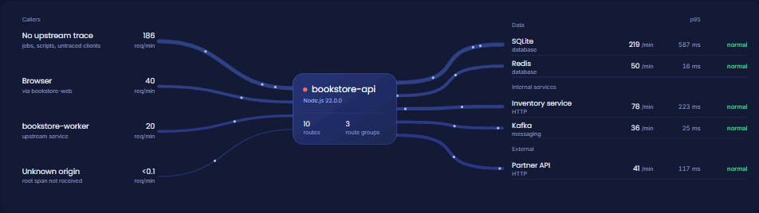
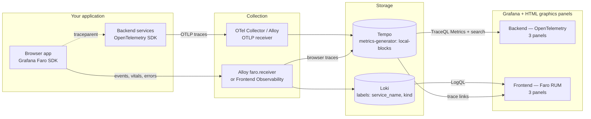
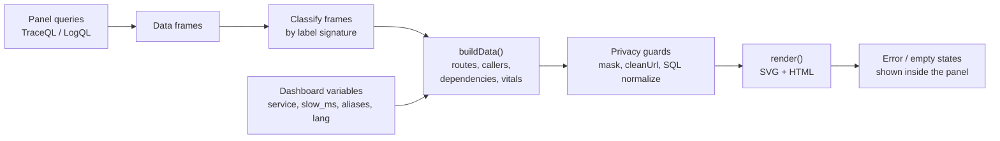
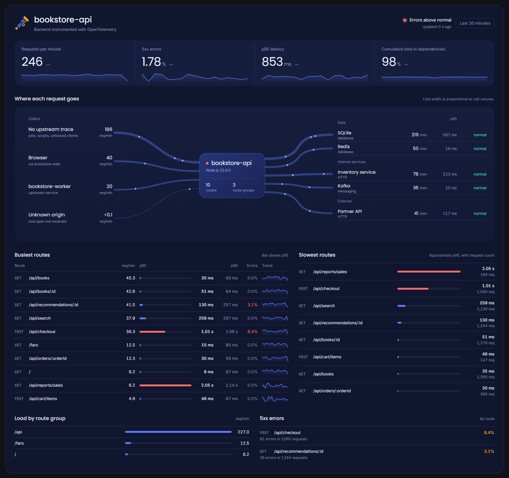
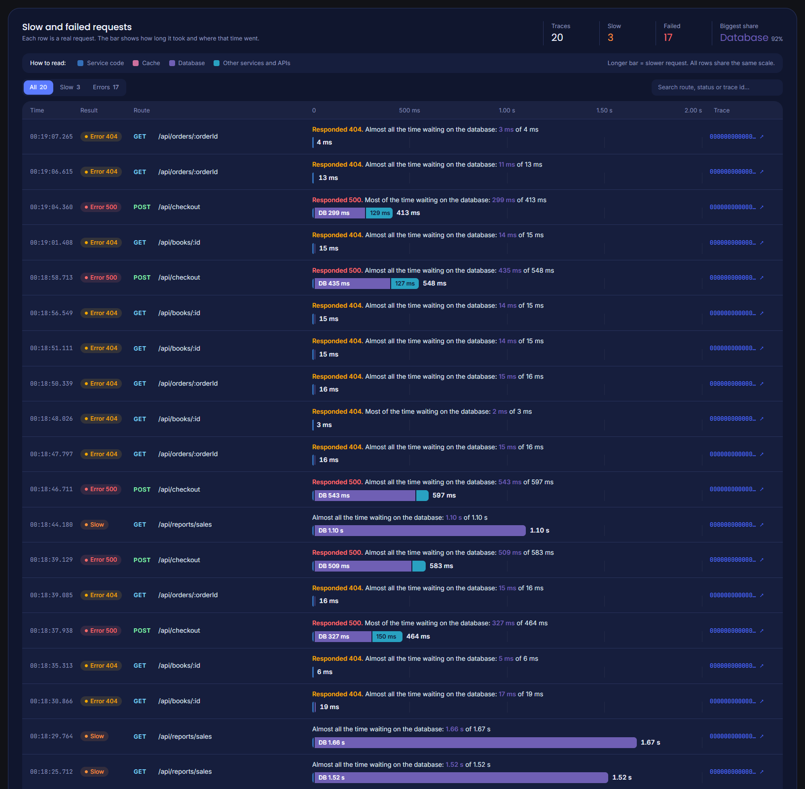
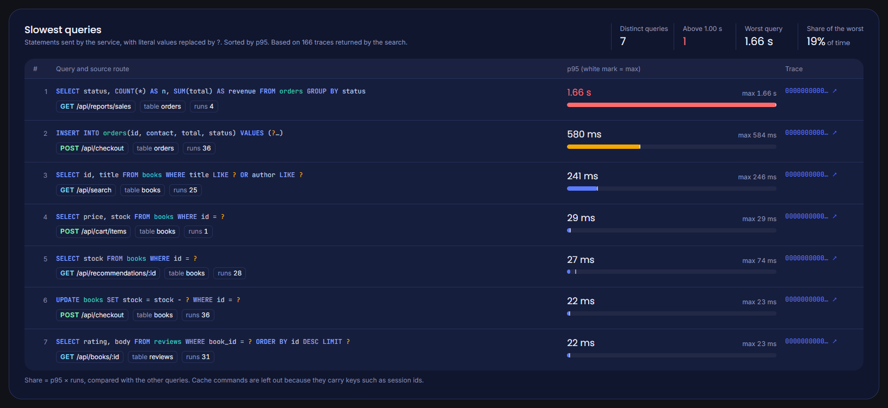
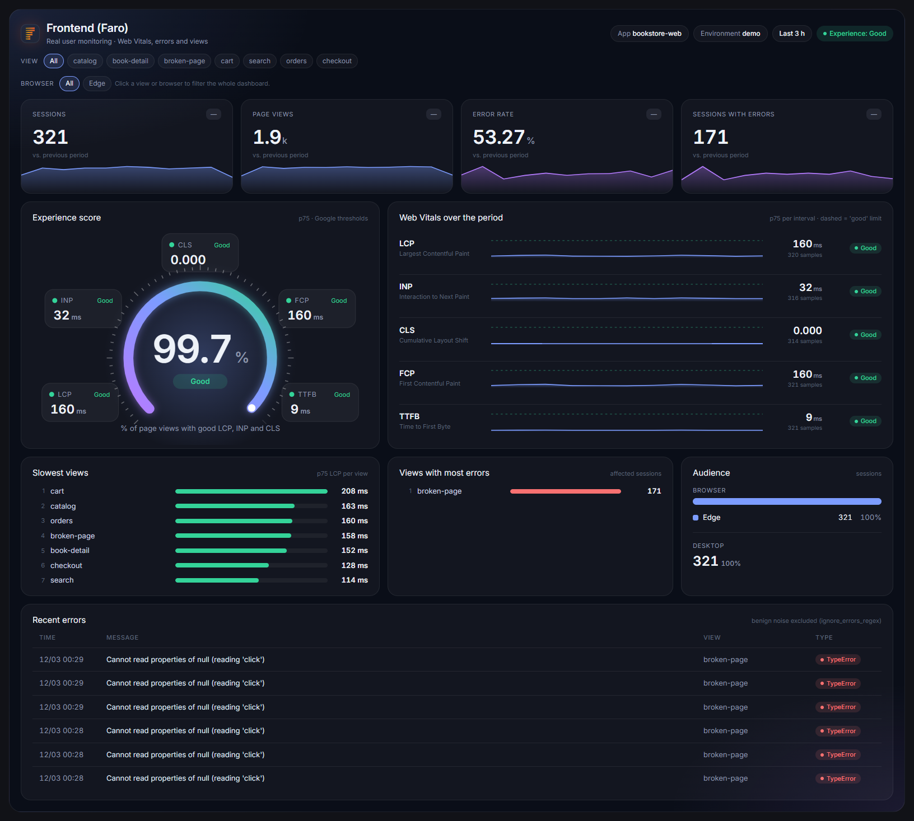
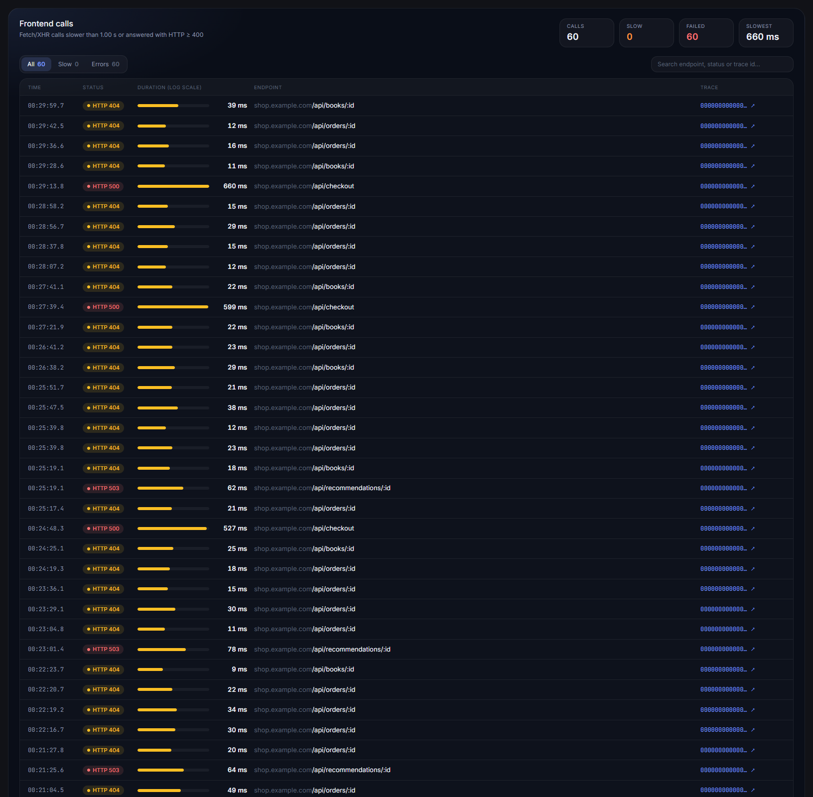
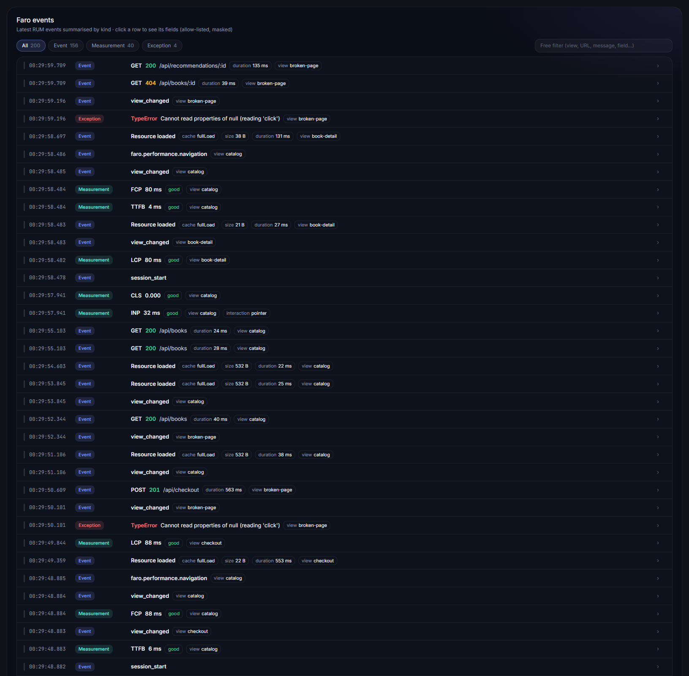

# OpenTelemetry & Faro dashboards for Grafana

Two importable dashboards that turn raw OpenTelemetry traces and Grafana Faro events into a service overview. You do not need spanmetrics, recording rules or code changes: everything is computed at query time from **your** Tempo and Loki.



| Dashboard | Datasource | Answers |
|---|---|---|
| **Backend  OpenTelemetry** | Tempo (TraceQL Metrics + search) | How busy and healthy is this service? Who calls it, what does it call, which routes, requests and SQL statements are slow? |
| **Frontend  Faro RUM** | Loki (+ Tempo for trace links) | How do real users experience the app? It covers sessions, error rate, Web Vitals, slow and failing views, the audience, failed calls and raw events. |

Nothing in the JSON is tied to an account or an application. Services, routes, dependencies, SQL and traces are discovered at render time. What differs between applications (service, internal hosts, thresholds, aliases, language) is a dashboard variable.

---

## Architecture



### How a panel renders

Each panel is a [`gapit-htmlgraphics-panel`](https://grafana.com/grafana/plugins/gapit-htmlgraphics-panel/). Its JavaScript turns the raw data frames into the view, inside the panel's shadow DOM.



- **Frame classification.** The Tempo datasource renames metric frames, so a `refId` cannot identify them. Each metrics query groups by a unique combination of intrinsics that are never empty (`kind`, `status`, `resource.service.name`, `trace:rootService`). The panel recognises each frame by that signature.
- **One shared runtime** (`src/shared/runtime.js`) is injected into every panel at build time. It handles variables, the en/pt-BR dictionary, masking, Explore links, embedded fonts, and error and empty states.
- **No external requests.** Fonts and logos are embedded, and nothing is written to the browser console.

---

## Dashboards

### Backend — OpenTelemetry

| Panel | What it shows | Queries |
|---|---|---|
| **Overview** | KPIs (req/min, 5xx %, p95, time spent in dependencies), the animated flow map of callers and dependencies, busiest and slowest routes, load by route group, 5xx by route, runtime from resource attributes | 19 TraceQL Metrics |
| **Slow and failed requests** | The last requests above `slow_ms` or answered with HTTP ≥ 400, with each one's time split between service code, database, cache and other services | 1 TraceQL search (100 traces) |
| **Slowest queries** | Database statements grouped by normalized text, with p95, max, source route and an example trace | 1 TraceQL search (500 traces) |

How the flow map is built:

- **Callers** are discovered from `trace:rootService`: the browser app, upstream services, or *no upstream trace*. Consumer and RPC spans are added to them.
- **Dependencies** are discovered from client and producer spans:
  - *Data*: any `db.system.name` / `db.system`;
  - *Internal services*: hosts matching `internal_hosts_regex`, plus messaging;
  - *External*: everything else.



<details><summary>Slow and failed requests · Slowest queries</summary>




</details>

### Frontend — Faro RUM

| Panel | What it shows | Queries |
|---|---|---|
| **Overview** | Sessions, page views, error rate and sessions with errors (each against the previous period), the experience score (% of good LCP/INP/CLS), the 5 Web Vitals at p75 with Google thresholds, the slowest and most failing views, the audience, recent errors. Clicking a view or browser filters the whole dashboard. | 34 LogQL |
| **Frontend calls** | Fetch/XHR calls above `slow_ms` or with HTTP ≥ 400, as URL templates, linked to their traces | 2 LogQL |
| **Faro events** | The latest 200 events, summarised by kind, with an allow-listed field view | 1 LogQL |



<details><summary>Frontend calls · Faro events</summary>




</details>

All screenshots are rendered from [`demo/frames.json`](demo/), which holds fictitious data from a synthetic bookstore application. The dashboards never read that file. Portuguese versions are in `docs/images/*.pt-BR.png`.

---

## Quick start

1. **Install the panel plugin.** Run `grafana cli plugins install gapit-htmlgraphics-panel`, or install it from the catalog on Grafana Cloud.
2. **Import the dashboards.** Go to **Dashboards → New → Import** and upload a file from `dashboards/`.
3. **Pick the datasources** on the import screen: Tempo (and Loki for the frontend dashboard).
4. **Choose the target.** Select a **Service** (backend) or an **App** (frontend); both lists come from your data.

The dashboard UIDs are `otel-backend-overview` and `faro-frontend-overview`. Importing over an existing dashboard with the same UID replaces it, so change the UID on the import screen to keep both.

## Requirements

| Component | Requirement |
|---|---|
| Grafana | Tested on 13.2.3 (OSS); Grafana Cloud works the same way |
| Panel plugin | `gapit-htmlgraphics-panel`, tested with 2.2.3 |
| Tempo | **TraceQL Metrics** enabled: metrics-generator with the `local-blocks` processor (enabled in Grafana Cloud Traces). When self-hosting, set `filter_server_spans: false` so client spans count. No spanmetrics or Prometheus/Mimir datasource is needed. |
| Loki | Receives Grafana Faro logs (see [Telemetry contract](#telemetry-contract)) |

## Configuration

### Backend variables

| Variable | Default | Purpose |
|---|---|---|
| `tempo_ds` | import input | Tempo datasource for every panel and trace link |
| `service` | — | `service.name` to inspect; values come from Tempo |
| `frontend_service` | empty | `service.name` of the browser app. Traces that start there are drawn as the **Browser** caller. |
| `internal_hosts_regex` | empty | Regex tested against `server.address` / `peer.service`. Matches go under **Internal services**; when empty, every non-database host is **External**. Example: `.*\.svc\.cluster\.local\|^inventory$` |
| `slow_ms` | `1000` | Slow threshold in milliseconds (integer). It also sets the latency colours. |
| `name_overrides` | `{}` | JSON aliases keyed by host, `db.system`, `messaging.system` or service name. Values are a name or `{"name":…,"kind":…}`. Example: `{"api.partner.example":"Partner API"}` |
| `lang` | `en` | Panel language: `en` or `pt-BR` |

### Frontend variables

| Variable | Default | Purpose |
|---|---|---|
| `loki_ds`, `tempo_ds` | import inputs | Loki with Faro logs; Tempo for trace links |
| `app` | — | Faro app (`service_name` label); values come from Loki |
| `environment` | All | `deployment_environment` label; values come from Loki |
| `view`, `browser` | `.*` | Regex on `view_name` / `browser_name`. They are parsed fields, not Loki labels, so they are picked in the overview panel's filter bar, whose values come from a Loki query. |
| `device` | All | Desktop or Mobile (`browser_mobile`) |
| `slow_ms` | `1000` | Slow call threshold in milliseconds |
| `ignore_errors_regex` | `(?i).*ResizeObserver loop.*` | Exceptions treated as benign noise; `^$` ignores nothing |
| `lang` | `en` | `en` or `pt-BR` |

Item limits, the trace-link range, cache systems and other defaults are named constants at the top of each panel's source in `src/`.

## Telemetry contract

### Spans read by the backend dashboard

The queries use the **stable** semantic conventions. Older SDKs can emit the stable HTTP attributes with `OTEL_SEMCONV_STABILITY_OPT_IN=http`.

| Attribute | Used for |
|---|---|
| `service.name`, `telemetry.sdk.language`, `process.runtime.name`, `process.runtime.version` (resource) | service selection, runtime in the central card |
| server spans: `http.route`, `http.request.method`, `http.response.status_code` | routes, rate, errors, latency |
| client spans: `db.system.name` or `db.system` | Data dependencies (any database or cache) |
| client / producer spans: `messaging.system` | messaging dependencies |
| client spans: `http.request.method` or `rpc.system`, with `server.address` / `peer.service` | HTTP and RPC dependencies |
| client spans: `db.query.text` or `db.statement`, `db.collection.name` or `db.sql.table` | slowest queries |
| consumer spans (`messaging.system`), RPC server spans (`rpc.system`) | non-HTTP callers |
| `trace:rootService` (intrinsic) | callers |

When an attribute is missing, the block that depends on it shows a note naming the expected attribute, instead of zeros.

### Faro logs read by the frontend dashboard

- **Stream labels:** `service_name` (app), `kind` (`event`, `measurement`, `exception`, `log`) and, optionally, `deployment_environment`.
- **Body:** logfmt with Faro's usual fields (`event_name`, `view_name`, `browser_name`, `browser_mobile`, `session_id`, Web Vitals, `event_data_*`).

Grafana Cloud Frontend Observability already writes this format. With a self-hosted Alloy:

```alloy
faro.receiver "default" {
  server { listen_address = "0.0.0.0"  listen_port = 12347  cors_allowed_origins = ["https://your-app.example"] }
  output { logs = [loki.process.faro.receiver]  traces = [otelcol.exporter.otlp.tempo.input] }
}
loki.process "faro" {
  stage.logfmt { mapping = { "kind" = "", "app_name" = "", "app_environment" = "" } }
  stage.labels { values = { "kind" = "", "service_name" = "app_name", "deployment_environment" = "app_environment" } }
  forward_to = [loki.write.default.receiver]
}
```

## Privacy by design

These protections are always on and covered by `scripts/test.mjs`:

- **Loki log queries end with `| keep kind`.** Without it, Loki returns every parsed logfmt field (session ids, user agent, full URLs) as frame labels. The events panel also returns only an allow-list of fields, through `line_format`.
- **Free text is masked:** e-mails, JWTs, bearer tokens, `token=` / `password=` / `session=` values, UUIDs, long hex ids, IPs and long numbers.
- **URLs** lose their query string and fragment; id-like path segments become `:id`.
- **SQL is normalized:** comments are removed (including `traceparent` comments), and literals, e-mails, UUIDs, hex, `IN (…)` and `VALUES (…)` become `?`. Cache commands (Redis, Valkey, Memcached…) are excluded in the TraceQL query itself, because they carry keys such as session ids.

## Design decisions

- **TraceQL Metrics instead of spanmetrics.** There is no extra series cost and nothing to configure in the collector; the trade-off is query cost per refresh.
- **Search and metrics never share a panel.** The Tempo datasource runs every TraceQL query in a panel as the type of the first one.
- **At most 5 attributes per `by()`.** This is Tempo's limit, and the reason dependencies are counted per type and the stable conventions are required.
- **`view` and `browser` are text variables.** Grafana's Loki variables can only list indexed labels, so the overview panel provides the picker.

## Known limitations

- **Spans per trace in search:** at most 100 (`spss`). Traces that hit the limit appear without the time breakdown.
- **Approximate p95:** `quantile_over_time` uses power-of-two buckets.
- **Samples:** the search panels read up to 100 slow or failed requests and up to 500 traces with SQL. Their footers show the count.
- **No backend KPI delta:** comparing periods would double the TraceQL Metrics cost.
- **Requests without client spans:** slow requests that never call a dependency are not listed in *Slow and failed requests*.
- **Cost per refresh:** with the default 5-minute refresh, the backend runs 19 TraceQL Metrics queries and 2 searches, and the frontend runs 37 LogQL queries. Widen the refresh or narrow the range on busy services.
- **SQL normalization runs in the browser:** the raw SQL travels from Tempo to the viewer's browser before it is normalized. Restrict who can open the dashboard.
- **Dashboard size:** each JSON is a few hundred KB, because the fonts are embedded.

## Development

```
src/backend/   overview (api), traces, queries — JS + CSS
src/frontend/  overview, calls, events — JS + CSS
src/shared/    runtime shared by every panel
src/fonts, src/assets   embedded fonts and logos
scripts/       build.mjs · test.mjs · render-demo.mjs
dashboards/    generated, importable JSON
demo/          fictitious frames used only for screenshots
```

```bash
npm run build   # src/ -> dashboards/
npm test        # privacy helpers + structural checks on the built dashboards
npm install && npm run demo   # screenshots and the animated GIF (needs Chrome or Edge)
```

## License

[MIT](LICENSE) © 2026 Felipe Galeti Gôngora. Third-party assets bundled in the dashboards (fonts and logos) keep their own licenses and terms; see [`NOTICE.md`](NOTICE.md) and [`licenses/`](licenses/).

## Credits and notices

- The OpenTelemetry logo is a trademark of The Linux Foundation, used under the [CNCF trademark guidelines](https://www.linuxfoundation.org/legal/trademark-usage) to refer to the project.
- The Grafana Faro icon is cropped, unmodified, from `docs/faro_logo_dark.png` of [grafana/faro-web-sdk](https://github.com/grafana/faro-web-sdk) (Apache-2.0). Grafana, Tempo, Loki and Faro are trademarks of Raintank, Inc. (Grafana Labs).
- **This project is not affiliated with, endorsed by or sponsored by OpenTelemetry, the CNCF, The Linux Foundation or Grafana Labs.**
- Embedded fonts: Poppins, Inter and JetBrains Mono, under the SIL Open Font License 1.1. See [`licenses/`](licenses/) and [`NOTICE.md`](NOTICE.md).

---

## Português

Dois dashboards importáveis que montam a visão de um serviço a partir dos traces OpenTelemetry (Tempo, TraceQL Metrics) e dos eventos do Grafana Faro (Loki). Eles não precisam de spanmetrics nem de mudança de código, e tudo é descoberto dos seus dados em tempo de execução.

- **Como importar:**
  1. Instale o plugin `gapit-htmlgraphics-panel`.
  2. Em **Dashboards → New → Import**, envie o JSON de `dashboards/`.
  3. Escolha os datasources Tempo e Loki.
  4. Selecione o **Service** ou o **App**.
- **Requisitos:**
  - Tempo com TraceQL Metrics (`local-blocks`; no self-hosted, `filter_server_spans: false`).
  - Convenções semânticas estáveis.
  - Logs do Faro no Loki com os labels `service_name` e `kind`.
- **Idioma:** a variável `lang` troca todos os textos para `pt-BR`.
- **Arquitetura, variáveis, contrato de telemetria, privacidade e limitações:** estão nas seções acima.
- **Licença:** MIT (veja [`LICENSE`](LICENSE)); fontes e logos de terceiros mantêm suas próprias licenças ([`NOTICE.md`](NOTICE.md)).
- **Não afiliação:** este projeto não é afiliado nem endossado pelo OpenTelemetry, pela CNCF, pela Linux Foundation ou pela Grafana Labs.
